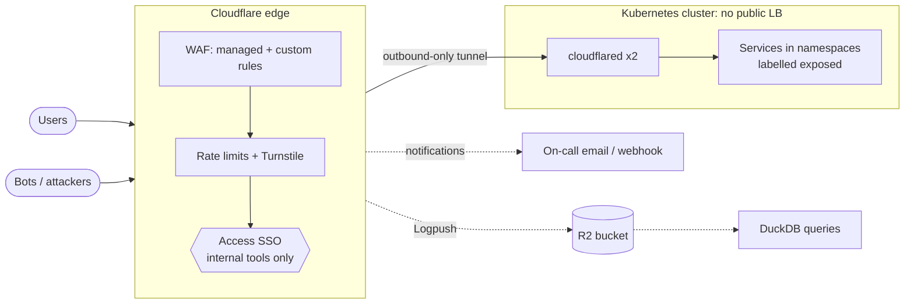

# cloudflare-edge-platform

Cloudflare in front of a Kubernetes platform, managed entirely as code.

The goal is a production edge that a small platform team can own:

- **Zone baseline:** strict TLS, HSTS and DNS defined in Terraform
- **WAF:** managed rulesets plus custom rules that live in version control
- **Rate limiting and bot defence** for login and API paths
- **Cloudflare Tunnel:** the cluster has no public load balancer at all
- **Cloudflare Access:** internal tools (Argo CD, Grafana) behind SSO, no VPN
- **Logpush to R2**, with ready-made queries for attack and false-positive analysis
- **Runbooks** for the incidents that actually happen at the edge

## Architecture



Design decisions are in [`docs/adr/`](docs/adr):

1. [Tunnel instead of a public load balancer](docs/adr/0001-tunnel-instead-of-public-load-balancer.md)
2. [Security rules as reviewed YAML](docs/adr/0002-security-rules-as-reviewed-yaml.md)
3. [Rate limit sizing](docs/adr/0003-rate-limit-sizing.md)
4. [Edge logs in R2, queried with DuckDB](docs/adr/0004-edge-logs-in-r2-queried-with-duckdb.md)

## Layout

```
terraform/                 root stack: provider, variables, module wiring, tests
terraform/modules/         zone-baseline, dns, waf, rate-limits, turnstile,
                           cache-headers, tunnel, access, logpush, notifications
policies/                  WAF and rate-limit rules (YAML, reviewed in PRs)
kubernetes/cloudflared/    cloudflared Deployment, PDB, NetworkPolicy (+ quick-tunnel overlay)
analytics/                 DuckDB queries over Logpush data, with tests
docs/adr/, docs/runbooks/  decisions and incident runbooks
tests/e2e/                 kind end-to-end checks
versions.env               pinned tool versions (Makefile + CI)
```

## Usage

No Cloudflare account is needed for the checks:

```bash
make check      # fmt, validate, tflint, terraform test (mocked provider)
make analytics  # DuckDB queries against synthetic logs
make e2e        # kind: admission, exposure and NetworkPolicy checks
```

CI runs all three, plus trivy (IaC misconfiguration and secret scan) and shellcheck.

To apply against a real zone, copy `terraform/terraform.tfvars.example` to
`terraform/terraform.tfvars`, export `CLOUDFLARE_API_TOKEN`, then run
`terraform -chdir=terraform plan`.

## Tests

`terraform test` runs against a mocked Cloudflare provider, so it checks the
real provider schema and our own rules without an account:

- **Root stack** (`terraform/tests/`): secure defaults, optional parts off by
  default, WAF and rate-limit rules loaded from YAML, a full setup with Tunnel,
  Access and Turnstile, and inputs that must be rejected.
- **Modules** (`terraform/modules/*/tests/`):
  - DNS: an unproxied origin needs a reason; anti-spoofing records.
  - Tunnel: routes only to in-cluster services; catch-all 404; origin TLS
    verified.
  - WAF and rate limits: unknown actions, duplicate refs, plan limits.

## Kubernetes e2e

`make e2e` creates a kind cluster and checks the cloudflared deployment:

- The manifests are admitted under the `restricted` Pod Security Standard.
- The cluster exposes no LoadBalancer or NodePort services.
- NetworkPolicy isolation, tested with a probe pod that carries cloudflared's
  labels: it reaches namespaces labelled `edge.cloudflare.com/exposed=true`,
  but not unlabelled namespaces or the Kubernetes API server.

Nothing is exposed to the internet by default. `E2E_PUBLIC_TUNNEL=1 make e2e`
adds a check through Cloudflare's real edge, using an account-less quick
tunnel. **It makes the demo origin publicly reachable** at a random
`trycloudflare.com` URL until the test finishes and removes the tunnel.

## Edge log analytics

`terraform/modules/logpush` pushes HTTP request logs to R2 with 30-day
retention. [`analytics/`](analytics/README.md) has DuckDB queries for blocked
clients, credential stuffing, WAF false positives, origin errors and cache
efficiency. They are tested against synthetic logs with known incidents
(`make analytics`).

## Alerts and runbooks

`terraform/modules/notifications` enables Cloudflare notifications for DDoS,
tunnel health, origin reachability, failing Logpush jobs, expiring service
tokens and certificate events. They go to a team email list and, optionally,
an on-call webhook. Each alert points to a runbook:

- [DDoS](docs/runbooks/ddos.md)
- [Tunnel down](docs/runbooks/tunnel-down.md)
- [Origin errors](docs/runbooks/origin-errors.md)
- [WAF false positive](docs/runbooks/waf-false-positive.md)
- [Credential stuffing](docs/runbooks/credential-stuffing.md)
- [Access service token rotation](docs/runbooks/access-service-token.md)

## What is and is not verified

- **Verified in CI:** Terraform against the real provider schema, with a mocked API
  (`terraform test`). Our validation rules, the Kubernetes manifests on a real cluster, and the
  log queries.
- **Opt-in:** the path through Cloudflare's real edge, using an account-less quick tunnel
  (`E2E_PUBLIC_TUNNEL=1`).
- **Not verified without an account:** applying to a real zone. Rule expressions are only fully
  validated by the Cloudflare API, and some features (OWASP managed rules, more than one rate
  limit rule, some notifications) need a paid plan.

## Secrets

The API token is only read from the environment. R2 credentials for Logpush are
sensitive variables passed as `TF_VAR_r2_*`. Nothing in this repository
contains account IDs, zone IDs or tokens, and `terraform.tfvars` is git-ignored.
